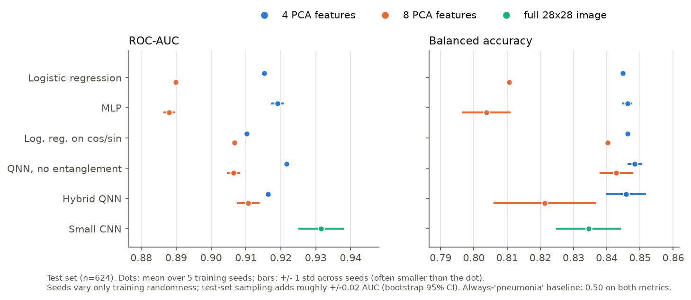

# Hybrid Quantum-Classical Classification of Chest X-Rays

A small, reproducible benchmark: classify PneumoniaMNIST chest X-rays (normal vs. pneumonia) with a
variational quantum circuit (PennyLane, simulated on CPU) trained end-to-end with PyTorch, and compare it
against classical baselines **and against controls designed to find out where any quantum-model
performance actually comes from**.

## Main result

**The hybrid quantum model does not outperform classical models.** On 4 PCA features it ties logistic
regression and a small MLP. On 8 features it beats them, but a classical logistic regression given the same
cos/sin encoding the circuit uses closes most of the gap. A version of the circuit with **no entanglement**
does the same, and that version can be simulated efficiently on a classical computer. A small CNN that sees the
full image has the best AUC. This is the expected outcome at this scale; see [Why](#why-the-quantum-model-doesnt-win).



Test-set ROC-AUC, mean ± std over 5 training seeds (n = 624 test images):

| model | input | trainable params | test ROC-AUC | balanced accuracy |
|---|---|---|---|---|
| always "pneumonia" | – | 0 | 0.500 | 0.500 |
| logistic regression | 4 PCA features | 5 | 0.915 ± 0.000 | 0.845 ± 0.000 |
| MLP (4→8→1) | 4 PCA features | 49 | 0.919 ± 0.002 | 0.846 ± 0.002 |
| logistic regression on cos/sin | 4 PCA features | 9 | 0.910 ± 0.000 | 0.846 ± 0.000 |
| QNN, no entanglement | 4 PCA features | 29 | 0.922 ± 0.000 | 0.848 ± 0.002 |
| **hybrid QNN** | 4 PCA features | 29 | **0.916 ± 0.001** | **0.846 ± 0.006** |
| logistic regression | 8 PCA features | 9 | 0.890 ± 0.000 | 0.811 ± 0.000 |
| MLP (8→8→1) | 8 PCA features | 81 | 0.888 ± 0.002 | 0.804 ± 0.007 |
| logistic regression on cos/sin | 8 PCA features | 17 | 0.907 ± 0.000 | 0.840 ± 0.000 |
| QNN, no entanglement | 8 PCA features | 57 | 0.906 ± 0.002 | 0.843 ± 0.005 |
| **hybrid QNN** | 8 PCA features | 57 | **0.911 ± 0.003** | **0.821 ± 0.015** |
| small CNN | full 28×28 image | 2,033 | 0.932 ± 0.006 | 0.835 ± 0.010 |

Logistic regression shows ± 0.000 because its solver is deterministic: the seed changes nothing.

**How big is a meaningful difference?** The ± above only reflects training randomness, because all seeds are scored
on the same 624 test images. Resampling the test set (2,000 bootstrap resamples, seed-0 predictions) gives a
95% interval of **0.895–0.940** for the 4-feature QNN's AUC. Paired 95% intervals for the differences:

| comparison (AUC difference) | 95% CI | reading |
|---|---|---|
| QNN@8 − logistic regression@8 | +0.012 to +0.039 | real gap on this test set… |
| QNN@8 − logistic regression on cos/sin@8 | −0.003 to +0.019 | …but mostly explained by the encoding |
| QNN@8 − QNN without entanglement@8 | −0.004 to +0.018 | entanglement: no clear benefit |
| CNN − QNN@4 | −0.006 to +0.032 | CNN likely better; not certain at n = 624 |

At k = 4 the no-entanglement circuit is slightly *better* than the entangled one on every seed (by 0.004–0.007 AUC).

## Method

```
28x28 X-ray -> 784 pixels in [0,1] -> PCA to k features -> rescale to [0, π] -> model
```

1. **Data** (`src/data.py`). The official MedMNIST train/val/test split: 4,708 / 524 / 624 images. The classes
   are imbalanced: 74% pneumonia in train and val, 62.5% in test. PCA and the [0, π] scaler are **fit on the
   training set only** (checked by a test). Four components keep 60% of pixel variance and eight keep 73%
   (`results/figures/pca_variance.png`).
2. **Quantum model** (`src/quantum.py`), with one qubit per feature:
   - RY(xᵢ) encoding;
   - 2 layers of `StronglyEntanglingLayers` (trainable Rot gates plus a ring of CNOTs);
   - ⟨Z⟩ measured on each qubit;
   - a `Linear(k, 1)` head.

   The circuit runs on `default.qubit` with exact expectation values. Gradients come from backpropagation
   through the simulator.
3. **Baselines** (`src/classical.py`):
   - majority class;
   - logistic regression;
   - an MLP with 8 hidden units;
   - a small 2-layer CNN on the full image.
4. **Controls** that isolate the quantum part:
   - *Logistic regression on cos/sin features.* A single RY-encoded qubit can only produce functions of
     cos(xᵢ) and sin(xᵢ), so this asks what a classical model gets from the same encoding.
   - *QNN without entanglement.* The same circuit with the CNOTs removed, so each qubit stays independent.
     This is an unentangled product state and is easy to simulate classically.
5. **Training** (`src/train.py`). All neural models share one loop:
   - Adam optimizer;
   - weighted binary cross-entropy (so both classes count equally);
   - batch size 64, up to 50 epochs;
   - early stopping on validation loss (patience 5), restoring the best weights.

   Learning rates: 0.01 for the MLP, 0.02 for the QNNs, 0.001 for the CNN. These were set by hand once and
   not tuned.
6. **Evaluation.** Test metrics only, computed once after training. We report balanced accuracy and ROC-AUC
   because plain accuracy and F1 look good for a model that always predicts "pneumonia" (accuracy 0.625,
   F1 0.769).

## Why the quantum model doesn't win

- **The information bottleneck happens before the qubits.** The circuit can only see k numbers. With k = 4 that is
  60% of pixel variance, and a 5-parameter logistic regression already extracts about as much from those 4
  numbers as any model here. The CNN sees the full image.
- **A few qubits are cheap to simulate.** A 4-qubit state is 16 complex numbers. Anything a circuit this size
  computes, a classical computer can compute exactly and quickly. That is literally how we ran it. A quantum
  advantage, if it exists for a problem, is only possible in regimes that are *hard* to simulate classically.
- **The no-entanglement control does just as well.** Without CNOTs the circuit is a weighted sum of sinusoids of
  each feature, which is a classical model. Its matching performance means the "quantum" part isn't doing
  anything a classical model couldn't.
- **The QNN's edge at k = 8 comes from the encoding, not the quantum part.** Logistic regression and the MLP drop
  from 0.915 to 0.890 when going from 4 to 8 features. That drop happens **only on the test set**: their
  validation AUC goes *up*, from 0.962 to 0.972. The validation set comes from the same pool as training; the
  test set behaves differently. The extra PCA components seem to capture train-specific variation. The bounded
  cos/sin encoding is less sensitive to that, whether it feeds a circuit or a logistic regression.

## What's notable for real hardware (not tested here)

These results use exact simulated expectation values. On real hardware:

- each ⟨Z⟩ is estimated from a finite number of shots, which adds noise;
- gates are noisy;
- gradients need the parameter-shift rule, which costs 2 circuit runs per parameter.

All three would make the quantum model **worse and slower**, not better.

## Limitations

- Small images (28×28), one dataset, one fixed split.
- 5 seeds. Only training randomness is varied; test-set uncertainty is estimated by bootstrap.
- Hyperparameters were not tuned per model. A tuned MLP or CNN would likely do better.
- The decision threshold is fixed at 0.5. The distribution shift between validation and test means a
  threshold tuned on validation may not carry over.
- Small circuit design space explored (one ansatz, 2 layers, angle encoding).
- Not a clinical tool. PneumoniaMNIST is a downsampled research benchmark.

## Reproduce

Tested with Python 3.13 on an Apple M1 MacBook Air, CPU only.

```bash
python3.13 -m venv .venv && source .venv/bin/activate
pip install -r requirements.txt
pytest -q                      # data tests (downloads PneumoniaMNIST, ~4 MB, into data/)
python -m src.benchmark        # all models, 5 seeds, k in {4, 8}, then all figures (~12 min)
python -m src.benchmark --seeds 1   # quick version (~2.5 min)
```

All random seeds are fixed: Python, NumPy, PyTorch, the data-loader shuffle, and deterministic PyTorch
kernels. Re-running on the same machine gives identical numbers. On different hardware or operating systems
the last decimal places may differ.

## Outputs

| file | contents |
|---|---|
| `results/metrics.csv` | one row per (model, k, seed): test accuracy, balanced accuracy, F1, ROC-AUC, validation AUC, params, train time |
| `results/summary.csv` | mean and std over seeds |
| `results/predictions_seed0.csv` | test-set probabilities (seed 0) |
| `results/histories_seed0.json` | loss curves (seed 0) |
| `results/figures/` | `performance.png`, `roc_curves.png`, `training_curves.png`, `pca_variance.png`, `samples.png` |

## Repository layout

```
src/data.py        load PneumoniaMNIST, normalize, PCA (fit on train only), scale to [0, π]
src/classical.py   majority, logistic regression (+ cos/sin control), MLP, small CNN
src/quantum.py     PennyLane variational circuit + PyTorch hybrid model (+ no-entanglement ablation)
src/train.py       seeding, shared training loop with early stopping, metrics
src/benchmark.py   runs everything, writes results/
src/plots.py       figures
tests/test_data.py shapes, ranges, label values, no PCA leakage, determinism
```

## Citation

Data: Yang, J. et al. *MedMNIST v2: A large-scale lightweight benchmark for 2D and 3D biomedical image
classification.* Scientific Data 10, 41 (2023). The underlying images are from Kermany, D. et al., *Cell* 172(5), 2018.
